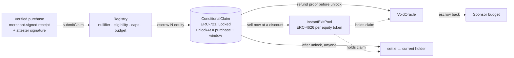

# Zen

**Every stock-back reward is a locked, conditional equity claim, because the purchase can be refunded.
Zen makes that claim a tradeable asset and creates the first onchain market that prices consumer refund risk, settled on Monad.**

Monad Metropolis · Onchain Finance & Trading · direction #12: *tokenized equities as a programmable asset: a contract that locks, streams, conditions, or distributes the equity itself.*

> Testnet demo. Every equity token is a clearly labelled **mock** (no affiliation with any brand, not a security, no value). The merchant is simulated. No users, partners, revenue or audits exist. See [Security and limits](#security-and-limits).

---

## The 2-minute pitch

**The problem nobody prices.** "Earn stock when you shop" programs (Bumped, Bits of Stock, Crumbs, Bitget Wallet's Assetback) all hit the same wall: a purchase is not final until its return window closes. In the US alone, consumers were expected to return **$849.9B** of merchandise in 2025, and 9% of returns were fraudulent ([NRF & Happy Returns, 2025](https://nrf.com/research/2025-retail-returns-landscape)). Return fraud cost retailers **$103B** in 2024 ([Appriss Retail & Deloitte](https://apprissretail.com/news/appriss-retail-annual-research-fraudulent-returns-and-claims-cost-retailers-103b-in-2024/)). A reward paid out on day 0 can be bought, returned and kept, so programs either eat that loss or make users wait weeks for "pending" rewards they can't touch.

**What a stock-back reward really is.** It is a *conditional* claim on equity: "N shares, unless this purchase is refunded within the return window". Zen puts exactly that object on-chain:

1. A verified purchase mints a **ConditionalClaim**: N units of a tokenized-equity ERC-20 escrowed from the sponsor's budget, locked until `purchaseTime + returnWindow(category)`.
2. **Void:** a refund proof before unlock cancels the claim and returns the equity to the sponsor. The wallet's refund history is recorded on-chain.
3. **Settle:** after unlock anyone can settle; the equity goes to whoever holds the claim.
4. **Instant exit:** the holder doesn't have to wait. They can sell the locked claim to an LP pool **now**, at a discount that prices refund risk, time and a fee.

That last step is the market: LPs earn the spread on claims that settle and lose the price paid on claims that get refunded. **Consumer refund risk becomes a priced, tradeable, onchain risk**, with returns that don't depend on crypto prices.

**Who it is for.** Stock-back issuers (the apps above) are our target customers: Zen is the settlement and refund-risk layer they lack, not another rewards app. LPs who want yield uncorrelated with crypto markets are the other side.

---

## Live demo and judge access

| | |
|---|---|
| Network | **Monad testnet** (chain 10143), explorer [testnet.monadvision.com](https://testnet.monadvision.com) |
| Contracts | [Addresses below](#contracts-and-addresses), all deployed by `script/DeployZen.s.sol` |
| Seeded activity | [Traction](#traction-real-testnet-transactions): 20 purchases, 8 instant exits, 2 refunds, the rest settled, from 4 wallets |
| Web app | `cd web && npm ci && npm run dev`, then open http://localhost:3000 ([quickstart](#quickstart)) |

**Try it as a judge (about 5 minutes):**
1. Add Monad testnet to your wallet and get MON from [faucet.monad.xyz](https://faucet.monad.xyz).
2. Open **/merchant** (simulated POS) and issue a merchant-signed receipt; scan its QR in **/app/scan** and claim. Your reward appears in **/app/portfolio** as a **Locked** claim with a countdown (a labelled 5–10 minute *demo window*; production windows are 14–30 days).
3. After the 60 s minimum hold, press **Cash out now**: the quote, the discount and what you give up are shown before you sign.
4. Or go back to **/merchant → Issue refund** on a claim the LP pool holds, and watch the pool's realized losses move in **/app/lp**.
5. Wait for the window to close and press **Settle**: the equity lands in the holder's wallet.

---

## How it works



| Contract | Role |
|---|---|
| `ReceiptCommitmentRegistry` | Verifies the attester's EIP-712 signature (ECDSA), burns a per-receipt nullifier, checks eligibility, caps and budget. Unchanged trust model from the prototype. |
| `RewardPool` | Sponsor budget per brand. `allocate` now escrows the reward and mints a ConditionalClaim instead of paying out. Voided escrow returns via `creditBudget`. |
| `ConditionalClaim` | ERC-721 positions: `equityToken, amount, category, unlockAt, originalClaimant, status {Locked, Voided, Settled}`. Transferable only while Locked. Indexed events for every state change. Tracks `escrowed[token]` and per-wallet claims/voids. |
| `VoidOracle` | Accepts EIP-712 `RefundAttestation(claimId, refundRef, deadline)` from allowlisted attesters (merchant-signed refunds, or refund emails verified off-chain). `refundRef` is a nullifier, so a refund can't be replayed. Only before unlock. |
| `InstantExitPool` | One single-asset ERC-4626 pool per equity token. `sellClaim(id, minOut)` pays from idle assets and takes the claim. `totalAssets = idle + book cost of held claims`; gains recognized at settle, losses at void; withdrawals limited to idle. |
| `BrandVault` | Admin-less ERC-4626 vault where a holder can deposit settled equity. |
| `AUSDRewardAdapter` | Optional: sponsors fund budgets in AUSD (Agora's dollar stablecoin on Monad; a **mock** on testnet), swapped with oracle-bounded slippage. |

---

## Why this needs Monad

- **Instant exit has to be instant.** The product promise is "cash out now". With 300 ms blocks and 600 ms full finality ([Monad docs](https://docs.monad.xyz/introduction/monad-for-developers)), a sell confirms before the user looks away; a sell that takes minutes is just another pending reward.
- **Per-claim settlement must cost less than the reward.** Every purchase is its own claim, settled one by one. At Monad's 100 MON-gwei minimum base fee our measured transactions cost fractions of a cent (table under [Traction](#traction-real-testnet-transactions)), so a ₹450 coffee can still carry its own claim.
- **Gas is billed on the gas *limit*.** Monad charges the limit, not gas used, so the deploy script, the seeding script and every frontend write set explicit, tight limits (`web/lib/chain.ts`, `GAS`).
- **No Stylus, no problem.** The registry verifies attestations with the ECDSA verifier; Foundry 1.8.5 runs the whole suite with `network = "monad"` (Monad gas model and opcode pricing).

---

## Pricing model

```
price = amount × (1 − pRefund[category] × walletRiskMult(originalClaimant))
               × (1 − timeValueBps × secondsToUnlock / YEAR)
               × (1 − lpFeeBps)

walletRiskMult = 1 + riskSlopeBps × voids / claims        (capped at 3×)
```

All factors are in basis points and computed on-chain (`InstantExitPool.priceFor`). Fuzz tests prove `price ≤ amount` and that price never rises when risk, wait or fee rise.

**Worked example (ILLUSTRATIVE parameters, not measured refund rates).** A 100-unit claim, production windows, 10%/yr time value, 1% LP fee:

| Claim | pRefund | Window | Wallet history | Price | Discount |
|---|---|---|---|---|---|
| Fashion | 25% | 30 days | clean | **73.64** | 26.4% |
| Electronics | 10% | 14 days | clean | **88.76** | 11.2% |
| Fashion, wallet refunded 1 of its 4 claims | 25% × 1.25 | 30 days | 25% void ratio | **67.50** | 32.5% |

If 25% of fashion claims really are refunded, the LP's expected value per claim is 75.00 against a price of 73.64: a 1.8% edge over 30 days, earned for carrying refund risk. If refunds run higher than priced, LPs lose; that is the risk being traded.

---

## Adverse selection and our defenses

The people most eager to sell a claim are the ones planning to return the item. Zen's defenses:

1. **Minimum hold** (`minHoldSeconds`, per category): a claim can't be sold the moment it's minted. The buyer has to commit before cashing out.
2. **Wallet refund history** (`walletRiskMult`): every void is recorded against the *original claimant*, and their future claims are priced with a higher haircut. Selling or transferring a claim doesn't wash the history.
3. **Refunds void the claim, not the cash.** A refunded buyer keeps whatever the pool paid, but the sponsor gets its equity back and the pool books the loss transparently. The loss is bounded by the price, which is set before the sale.
4. **Refund proofs are signed and nullified.** Voids need an allowlisted attester signature over a unique refund reference, so nobody can grief LPs by voiding at will, and one refund can't void two claims.
5. **Bounded parameters.** pRefund ≤ 90%, risk multiplier ≤ 3×, fee ≤ 10%, return window ≤ 90 days, enforced on-chain.

---

## Market

- **Returns:** $849.9B of US retail merchandise was expected to be returned in 2025; 9% of returns were fraudulent ([NRF & Happy Returns, *2025 Retail Returns Landscape*](https://nrf.com/research/2025-retail-returns-landscape)).
- **Return fraud:** $103B of losses to retailers in 2024; 15.14% of returns deemed fraudulent ([Appriss Retail & Deloitte, 2024](https://apprissretail.com/news/appriss-retail-annual-research-fraudulent-returns-and-claims-cost-retailers-103b-in-2024/)).
- **Stock-back is live and growing.** Bitget Wallet launched Assetback on 1 Aug 2026, paying up to 3% card cashback in tokenized stocks via xStocks ([GlobeNewswire](https://www.globenewswire.com/news-release/2026/08/01/3337111/0/en/bitget-wallet-card-turns-cashback-into-bitcoin-gold-and-tokenized-stocks.html)).

## Competition

| | What it does | What it lacks that Zen provides |
|---|---|---|
| **Bumped** | Brand-funded fractional-share rewards on card spend. Ended its reward programs in July 2022 and shut down in December 2022 ([Doctor of Credit](https://www.doctorofcredit.com/bumped-app-earn-stock-rewards-on-retail-purchases-by-linking-a-card/)). | Brands paid for every share up front; nothing priced or recovered refunded purchases. |
| **Bits of Stock** | Stock-reward programs sold to banks and credit unions ([bitsofstock.com](https://www.bitsofstock.com/)). | Off-chain, closed; no transferable claim, no refund-risk market. |
| **Bitget Wallet Assetback** | Card cashback paid in tokenized stocks, BTC or gold ([Bitget](https://web3.bitget.com/en/academy/how-bitget-wallet-card-assetback-works)). | Rewards are paid, not conditional; the issuer carries refund risk. |
| **Crumbs** | Tokenized-stock rewards on everyday spending ([BrokerChooser](https://brokerchooser.com/news/crumbs-brings-stock-tokenization-into-the-loyalty-rewards-game--02282c0d)). | Same: no settlement layer that locks, voids or prices the claim. |
| **SP3ND** | Pay for Amazon orders with USDC from a wallet ([Solana Compass](https://solanacompass.com/projects/sp3nd)). | A checkout rail, not a reward-settlement layer; a natural integration point for Zen claims. |

**Zen is the settlement and refund-risk layer these products lack, not another rewards app.** Any of them could mint Zen claims instead of paying rewards outright, and let users cash out through the pool.

## First users

- **LPs seeking returns uncorrelated with crypto.** Refund rates depend on retail categories and seasons, not on token prices.
- **Stock-back issuers are TARGET customers**, not current ones: we have no partnerships. Our first conversations would be with issuers that already carry refund risk on stock rewards.

---

## Traction (real testnet transactions)

From 3 shopper wallets and 1 LP wallet (all controlled by the team; **test trades, not users**). Full list with every hash: [`deployments/10143-activity.json`](deployments/10143-activity.json). Total: **75 transactions**.

| Action | Count | Gas charged per tx (= gas limit) | Cost per tx at 100 MON-gwei |
|---|---|---|---|
| LP deposit | 3 | 172,707 | 0.0173 MON |
| Purchase → conditional claim | 20 | 576,566 | 0.0577 MON |
| Instant exit (sell to pool) | 8 | 292,804 | 0.0293 MON |
| Refund → void | 2 | 297,751 | 0.0298 MON |
| Settle | 18 | 147,422 | 0.0147 MON |

Monad bills the gas **limit** (every receipt above reports gasUsed = gas limit), so the seeding script sets each limit to the estimate + 15%. Outcome: **20 claims → 8 cashed out to pools, 2 voided by refunds (one pool-held, a realized LP loss), 18 settled** (the 7 pool-held claims that settled are realized LP gains).

**Representative transactions**

| Step | Transaction |
|---|---|
| LP deposit mNKE pool | [`0xb7d3163f…bf128b`](https://testnet.monadvision.com/tx/0xb7d3163f204f547bb7c7c39d2962d84e45c60d63bc8936165b6b0d8020bf128b) |
| purchase fashion (NIKE) -> claim | [`0x9b0be7d4…8cfb8f`](https://testnet.monadvision.com/tx/0x9b0be7d442ade40acd7434cd5f3fee4065aa578acb416550893071f9eb8cfb8f) |
| purchase electronics (AAPL) -> claim | [`0x52eb072b…d511a4`](https://testnet.monadvision.com/tx/0x52eb072ba461856a49d82ffe6cb1978ee30455161dc7b9e5cb197e000dd511a4) |
| purchase food (SBUX) -> claim | [`0x4668cba3…d9fae1`](https://testnet.monadvision.com/tx/0x4668cba3a5242098537774589b4fc615bf0dd4cac252c68b83aad4cf0bd9fae1) |
| cash out claim #20 (SBUX) | [`0xfcb5f6fb…f01656`](https://testnet.monadvision.com/tx/0xfcb5f6fb9826ae790e494bdc6a2a84b39bf33efd18105a560b4cd7072df01656) |
| cash out claim #19 (SBUX) | [`0xfaf561b5…216190`](https://testnet.monadvision.com/tx/0xfaf561b5daf517318dec3c3442992d33f1d91cb4298db67f3c8e617f58216190) |
| cash out claim #18 (SBUX) | [`0x7f08009c…840a22`](https://testnet.monadvision.com/tx/0x7f08009c080447a01918daed13c549538432a29ac4cab627b558fd97ec840a22) |
| refund voids claim #6 (LP loss) | [`0xd509906b…b44f90`](https://testnet.monadvision.com/tx/0xd509906b68c509414221b96c229d400e89e9ac7e126f8dcc265bffb056b44f90) |
| refund voids claim #17 | [`0xb4a873b2…5da0de`](https://testnet.monadvision.com/tx/0xb4a873b226dd0f7f092c87d089c2cfaaa86cd1c121241952d7fbd697ee5da0de) |
| settle claim #7 (pool gain) | [`0xc64a751a…42a6bf`](https://testnet.monadvision.com/tx/0xc64a751a3f6db88d5fa7653eecf24d14af1b0fdfbd24b0547d403c9c3142a6bf) |
| settle claim #12 (pool gain) | [`0xdeb97802…e82fd5`](https://testnet.monadvision.com/tx/0xdeb978022193082bda2fcfb44b206901d96743b1327dc0696f1e59a340e82fd5) |
| settle claim #1 | [`0x1d32a7f7…53e63b`](https://testnet.monadvision.com/tx/0x1d32a7f7f905efaaf85853d4dfc7532f7bb42df9dbac401d7c13518b2253e63b) |
| settle claim #2 | [`0x1021dd68…4e2f04`](https://testnet.monadvision.com/tx/0x1021dd68c976d9d8fe6f67391f00394ecec817d5b54eb5d360fc5bdd974e2f04) |

Wallets: shoppers [`0x9Fbb76B05790e3411280424c99155CeE703A8123`](https://testnet.monadvision.com/address/0x9Fbb76B05790e3411280424c99155CeE703A8123), [`0x8c1209c18c78DEB56Eb2273d278bB2dA69507483`](https://testnet.monadvision.com/address/0x8c1209c18c78DEB56Eb2273d278bB2dA69507483), [`0xf529224C47b0D11FB1EF2A1E8DE2560f3453aE4b`](https://testnet.monadvision.com/address/0xf529224C47b0D11FB1EF2A1E8DE2560f3453aE4b); LP [`0xB32E17cA31d7628dD7C634153d330F7A5Eb1e908`](https://testnet.monadvision.com/address/0xB32E17cA31d7628dD7C634153d330F7A5Eb1e908).

---

## Next steps

| Step | Concrete target |
|---|---|
| Refund-rate data | Calibrate `pRefund` per category from public return-rate data (NRF publishes category rates) instead of illustrative values; publish the table on-chain. |
| Merchant signatures on Monad | Verify merchant P256 (passkey/HSM) signatures with Monad's P256 precompile at `0x0100` (EIP-7951), removing the attester from the merchant-receipt path. |
| Pilot | 1 stock-back issuer, 1 category (apparel), 1,000 claims with real 30-day windows on testnet, then measure realized refund rate vs priced rate. |
| Governance | Move category parameters and attester allowlists from the demo admin to a timelocked multisig; audit before any mainnet deployment. |
| Real equity | Replace mocks with issuer-authorized tokenized equity on Monad mainnet (chain 143). The mocks refuse to deploy there. |

---

## Security and limits

- **Demo admin.** Category windows, pricing parameters and attester allowlists are set by an `owner` key (bounded on-chain). Production: timelock or governance. The deployer key is a hot testnet key.
- **Attesters are trusted.** The purchase attester and the refund attester can mint and void claims within caps and budgets. A compromised attester is bounded by per-claim, per-user and per-brand daily caps and the sponsor's budget.
- **Mock assets.** Every equity token and AUSD on testnet is a mock that refuses to deploy on Monad mainnet (143) and Ethereum (1). Not securities, no value, no brand affiliation.
- **Simulated merchant.** The `/merchant` POS signs receipts with a demo key. DKIM-verified refund emails are a design, not built.
- **Refund probabilities are illustrative**, not measured.
- **Resolution callback is best effort.** ConditionalClaim notifies the pool with a gas-capped `try/catch`, so a broken holder can never block settlement; if a callback ever failed, anyone can call `InstantExitPool.reconcile(id)`.
- **eth_getLogs limits.** Monad's public RPC caps log queries at 100 blocks, so the app reads state by enumerating claim ids rather than scanning events.
- **Not audited.** 96 Foundry tests and 6 invariants pass (below); that is not an audit.

See [SECURITY.md](SECURITY.md) for the full threat model.

### Tests

`forge test` (Foundry 1.8.5, `network = "monad"`): **96 tests + 6 invariants, all passing**. Highlights:

- Full lifecycle: claim → lock → sell → settle (LP gain); claim → void (escrow back to sponsor); sell → void (LP loss); settle pays the current holder after transfer.
- Guards: minimum hold, slippage `minOut`, only holder can sell, no sale after unlock, insufficient liquidity, void after unlock rejected, replayed refund rejected, non-allowlisted attester rejected, expired attestation, only pool mints, only oracle voids, resolved claims are frozen, one-time wiring, bounded params.
- Pricing fuzz (1,000 runs each): `price ≤ amount`; monotonic in refund risk, wallet risk and time to unlock.
- ERC-4626: LP share math with gains and losses (late LPs pay the higher NAV; losses are shared pro rata); withdrawals limited to idle.
- Invariants (128 runs × 64 calls): escrowed equity == sum of Locked claim amounts (and fully backed), conservation of funded equity, exit-pool books == held claims, no receipt rewarded twice, daily caps.

---

## Contracts and addresses

Monad testnet (10143), `deployments/10143.json`. Explorer: `https://testnet.monadvision.com/address/<address>`.

| Contract | Address |
|---|---|
| ReceiptCommitmentRegistry | [`0x41d3E78DbF601fEAe80Be16778BC893C44d47917`](https://testnet.monadvision.com/address/0x41d3E78DbF601fEAe80Be16778BC893C44d47917) |
| ConditionalClaim | [`0xa5881243DAFDebb756a107E5D67C4647463FF54C`](https://testnet.monadvision.com/address/0xa5881243DAFDebb756a107E5D67C4647463FF54C) |
| VoidOracle | [`0x9b3181e6Fd79017d4781Fbf5C335F97AaC2CA266`](https://testnet.monadvision.com/address/0x9b3181e6Fd79017d4781Fbf5C335F97AaC2CA266) |
| RewardPool | [`0x5297f5F614aADEA458908609aF17ee441111e7a8`](https://testnet.monadvision.com/address/0x5297f5F614aADEA458908609aF17ee441111e7a8) |
| InstantExitPool · mNKE (fashion) | [`0x839968a1e28Ba5D605c602eC42d0e796D4614749`](https://testnet.monadvision.com/address/0x839968a1e28Ba5D605c602eC42d0e796D4614749) |
| InstantExitPool · mAAPL (electronics) | [`0x82F0727a82d838A3DD4fB4B85459d92C509D80e6`](https://testnet.monadvision.com/address/0x82F0727a82d838A3DD4fB4B85459d92C509D80e6) |
| InstantExitPool · mSBUX (food) | [`0x5704263f22029f93Ec555e2ecc26E4E4C5492e7a`](https://testnet.monadvision.com/address/0x5704263f22029f93Ec555e2ecc26E4E4C5492e7a) |
| ECDSAAttestationVerifier | [`0x794D50b6C237b68AB6b412fc60a0E0E70c0B6f72`](https://testnet.monadvision.com/address/0x794D50b6C237b68AB6b412fc60a0E0E70c0B6f72) |
| EligibilityPolicy | [`0xB661DE373b8fa87fdA1B9074c079F419fD06Adf2`](https://testnet.monadvision.com/address/0xB661DE373b8fa87fdA1B9074c079F419fD06Adf2) |
| RewardPolicy | [`0x703649Dc451e1ED6d4153C11d348c5118CC82e98`](https://testnet.monadvision.com/address/0x703649Dc451e1ED6d4153C11d348c5118CC82e98) |
| BrandVaultFactory | [`0x896c5FEBa5C04f2C99d6680562ded89d4c941C7a`](https://testnet.monadvision.com/address/0x896c5FEBa5C04f2C99d6680562ded89d4c941C7a) |
| BrandVault · mNKE | [`0xABBb168b73Ec6e27b5a4B40a3Ac1bf192Ff117Db`](https://testnet.monadvision.com/address/0xABBb168b73Ec6e27b5a4B40a3Ac1bf192Ff117Db) |
| BrandVault · mAAPL | [`0x5aA99b66164ed749CeDa3c7e546c1b912725B1a8`](https://testnet.monadvision.com/address/0x5aA99b66164ed749CeDa3c7e546c1b912725B1a8) |
| BrandVault · mSBUX | [`0x548251cA5c9150fAAA501f174Ffd93Efb9E20258`](https://testnet.monadvision.com/address/0x548251cA5c9150fAAA501f174Ffd93Efb9E20258) |
| AUSDRewardAdapter | [`0xAc2e14F29776e284583112285Bd138423fa08bF7`](https://testnet.monadvision.com/address/0xAc2e14F29776e284583112285Bd138423fa08bF7) |
| Mock Nike Equity (TEST) mNKE | [`0x150C20659F38EC7E0960F7Dd879df79316b18E42`](https://testnet.monadvision.com/address/0x150C20659F38EC7E0960F7Dd879df79316b18E42) |
| Mock Apple Equity (TEST) mAAPL | [`0x0e7bD98EFA397b19534A68063394CfB79c1314F9`](https://testnet.monadvision.com/address/0x0e7bD98EFA397b19534A68063394CfB79c1314F9) |
| Mock Starbucks Equity (TEST) mSBUX | [`0xA05920cda2727b81A4791b419c403CAba28D7f2F`](https://testnet.monadvision.com/address/0xA05920cda2727b81A4791b419c403CAba28D7f2F) |
| MockAUSD (TEST) | [`0x33D54a63fe5aC80e4FD7A522e50e1dd2Ed527973`](https://testnet.monadvision.com/address/0x33D54a63fe5aC80e4FD7A522e50e1dd2Ed527973) |
| MockSwapRouter (TEST) | [`0xfd0e872De125b64b821385B514333cAaCf7Ec589`](https://testnet.monadvision.com/address/0xfd0e872De125b64b821385B514333cAaCf7Ec589) |
| Deployer (demo admin) | [`0x5aB3036C7d0bA7043E0BB531374dC6c732eC4954`](https://testnet.monadvision.com/address/0x5aB3036C7d0bA7043E0BB531374dC6c732eC4954) |
| Purchase + refund attester | [`0x413d9C4b29823edC0bA443AD0B3702fe2B96b191`](https://testnet.monadvision.com/address/0x413d9C4b29823edC0bA443AD0B3702fe2B96b191) |

---

## Quickstart

```bash
# contracts (Foundry >= 1.8 for Monad execution)
forge build && forge test

# deploy (Monad testnet); Monad bills the gas limit, so keep the estimate multiplier tight
cp .env.example .env.local   # DEPLOYER_PRIVATE_KEY, ATTESTER_ADDRESS
forge script script/DeployZen.s.sol --rpc-url monad_testnet --broadcast --slow --gas-estimate-multiplier 110

# seed real activity (3 shoppers + 1 LP, ~20 claims, sells, refunds, settles)
node --env-file=.env.local --env-file=web/.env.local script/seed-activity.mjs

# web app
cd web && npm ci && npm run sync-contracts && npm run dev
```

`web/.env.local` needs `ATTESTER_ECDSA_KEY`, `ATTESTER_SALT`, `MERCHANT_ED25519_SEED`, `MERCHANT_ED25519_PUBLIC_KEY` (see `web/.env.example`). Never commit them.

## Repository

```
src/        ConditionalClaim, VoidOracle, InstantExitPool, registry, policies, reward pool, vaults, AUSD adapter, mocks
test/       lifecycle, pricing fuzz, LP accounting, security, invariants
script/     DeployZen.s.sol (deploy), seed-activity.mjs (testnet activity)
deployments/10143.json, 10143-activity.json
web/        Next.js app: shopper, merchant, LP terminal
```

## License and attribution

MIT ([LICENSE](LICENSE)). The Foundry setup, the oracle-freshness and slippage checks in the AUSD adapter, `IAggregatorV3`, `ISwapRouter` (corrected to the SwapRouter02 layout) and the stablecoin/aggregator mocks are adapted from **[Wield](https://github.com/useWield/wield-contracts)** (MIT, © 2026 Wield). The receipt-verification core comes from this team's earlier prototype; the conditional-claim lifecycle, VoidOracle, InstantExitPool, refund-risk pricing, Monad deployment and LP terminal were built during Monad Metropolis.
